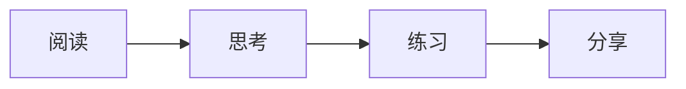
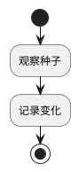

# 插件用法

<NpmBadge name="vitepress-tuck" />

本站已接入 vitepress-tuck 官方的 24 个功能插件，以及官方文档站使用的 LLMs 和代码组图标插件。节点端插件集中在 `docs/.vitepress/plugins/index.ts`，水印配置在 `docs/.vitepress/theme/index.ts`。

嵌入第三方视频、在线编辑器和仓库卡片时，需要访问对应服务；PlantUML 默认使用官方在线渲染服务。PDF 请替换为自己的文件路径。图标已安装 Lucide 图标集，构建时不自动下载图标。

## 文本与教学提示

### 缩写 abbr

HTML 可以用来组织网页内容。

*[HTML]: 超文本标记语言

### 注释 annotation

植物通过光合作用制造养分。[+光合作用]

[+光合作用]: 绿色植物利用光能，将二氧化碳和水转化为有机物，并释放氧气。

### 高亮 mark

==每天阅读二十分钟==，让知识生根。

### 隐藏答案 plot

先想一想：2 × 3 = !!6!!。

### 折叠内容 collapse

::: collapse

- 查看解题思路

  将三个 2 相加：2 + 2 + 2 = 6。

:::

### 步骤 steps

::: steps

1. 阅读题目

   找出已知条件。

2. 选择方法

   用画图、列式等方法求解。

3. 检查答案

   将结果代回题目。

:::

### Obsidian 语法 obsidian

> [!TIP]
> 可以在 Markdown 中直接使用 Obsidian 风格提示框。

[[markdown-examples|查看 Markdown 示例]]

%% 这段笔记不会显示在页面中。 %%

### 图标 icons

::lucide:sprout:: 让成长发芽。::lucide:book-open:: 开始阅读。

## 代码与结构

### 代码折叠 code-collapse

```js :collapsed-lines
const subjects = ['语文', '数学', '英语']
for (const subject of subjects) {
  console.log(subject)
}
console.log('每天进步一点点')
```

### 代码树 code-tree

::: code-tree title="课程示例"

```js [course.js]
export const course = { title: '观察植物' }
```

```json [lesson.json]
{ "subject": "科学", "grade": 3 }
```

:::

### 文件树 file-tree

::: file-tree title="学习资源"

- 语文/
  - 阅读.md
- 数学/
  - 练习.md

:::

### 字段说明 field

::: field grade
@type Number
@default 1
资源适用的年级。
:::

### 包管理器命令 npm-to

::: npm-to

```sh
npm install vitepress-tuck
```

:::

## 图表

### Mermaid



### PlantUML



### 二维码 qrcode

@[qrcode card title="VitePress 中文文档"](https://vitepress.dev/zh/)

## 嵌入内容

下面的语法可直接复制到课程页面。示例中的作品 ID、视频 ID 和文件路径需要换成自己的资源。

### 浏览器兼容性 caniuse

```md
@[caniuse](fetch)
```

### CodePen

```md
@[codepen](用户名/作品ID)
```

### JSFiddle

```md
@[jsfiddle](用户名/作品ID)
```

### StackBlitz

```md
@[stackblitz](项目ID)
```

### PDF

将文件放入 `docs/public/resources/lesson.pdf`，然后使用：

```md
@[pdf height="600px"](/resources/lesson.pdf)
```

### 视频 video

已开启 Bilibili、YouTube、AcFun 和 ArtPlayer。

```md
@[bilibili](视频BV号)
@[youtube](视频ID)
@[acfun](视频ID)
@[artPlayer](https://example.com/lesson.mp4)
```

### 仓库卡片 repo-card

```md
@[repo](vuejs/vitepress)
```

## 水印 watermark

全局默认关闭水印，仅本页通过 frontmatter 启用浅色「知芽 EduSprout」水印：

```yaml
---
watermark:
  content: 知芽 EduSprout
  globalAlpha: 0.06
---
```

也可将 `watermark` 设为自定义文本。

## 参考文档

- [VitePress 中文文档](https://vitepress.dev/zh/)
- [VitePress 源码](https://github.com/vuejs/vitepress)
- [vitepress-tuck 源码及完整插件清单](https://github.com/pengzhanbo/vitepress-tuck)
- [vitepress-tuck 中文插件文档](https://tuck.pengzhanbo.cn/zh/plugins/intro)

## LLMs 文档导出 llmstxt

采用与 vitepress-tuck 官方文档站相同的封装，生产构建生成 `/llms.txt`、`/llms-full.txt` 和页面 Markdown 文件，并在文档页提供复制或下载 Markdown 的按钮。开发模式不生成这些文件和按钮。

## 代码组图标 groupIcons

代码组标签根据名称显示工具或文件图标：

::: code-group

```sh [npm]
npm install vitepress-tuck
```

```sh [pnpm]
pnpm add vitepress-tuck
```

:::

## 自定义组件

组件统一放在 `docs/.vitepress/theme/components/`，通过 vitepress-tuck 的 `components.dirs` 自动导入。Markdown 中可直接使用组件，无需手动 import 或全局注册。

当前 `NpmBadge.vue` 参考官方组件实现，展示 npm 版本、月下载量、安装大小与许可证徽章：

```md
<NpmBadge name="vitepress-tuck" />
```

徽章图片依赖 Shields.io 服务。
